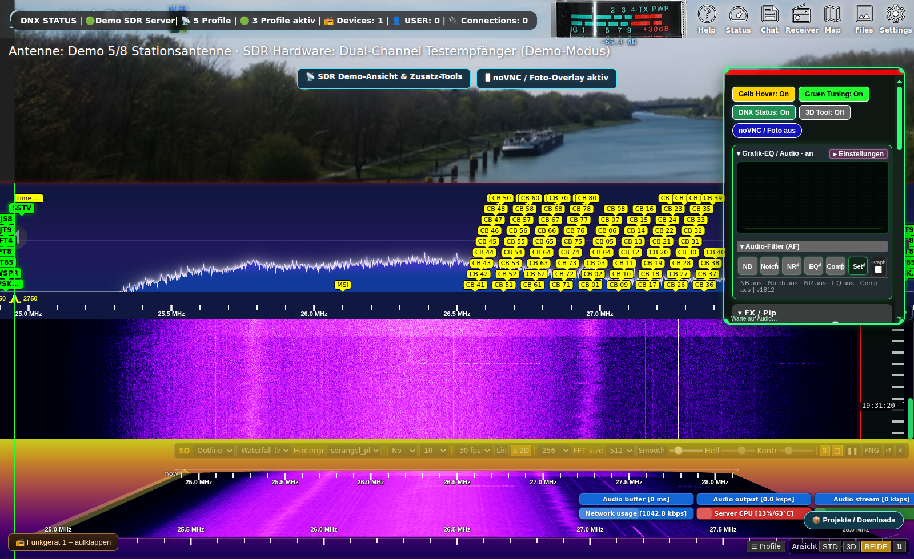
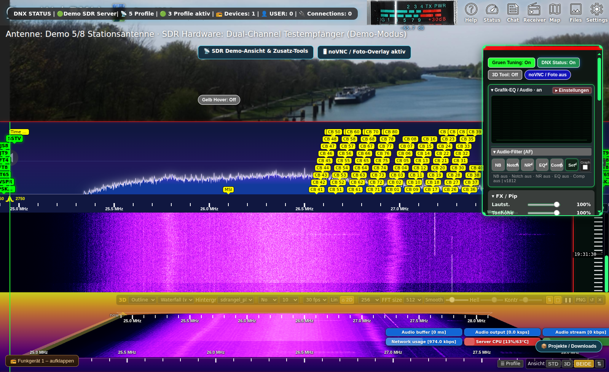

# DNX Yellow Hover & Green Tuning Lines (`v1.1.0`)

<!-- DNX-DISCLAIMER-START -->
> **Wichtiger Hinweis / Vollständige Distanzierung (Hobby-Mod-Mode)**
>
> - **Vollständige Distanzierung:** Ich distanziere mich in jeder Hinsicht vollständig vom Projekt **OpenWebRX / OpenWebRX+** sowie dessen Entwicklern und Betreibern. Es besteht keinerlei Verbindung, Zusammenarbeit, Prüfung, Befürwortung oder Partnerschaft.
> - **Keine öffentlichen/offiziellen OpenWebRX-Plugins (nur Mod-Mode):** Bei diesem Projekt handelt es sich ausdrücklich **nicht** um ein öffentliches oder offizielles Plugin von OpenWebRX, sondern ausschließlich um einen privaten, inoffiziellen **Mod-Mode** (Eigenmodifikation).
> - **Warum bewusst kein reines Browser-JavaScript (Mod-Mode-Architektur):** Viele Funktionen (z. B. serverseitige Speicherung, Konten-/Rollenverwaltung, Profil-Synchronisation, VNC-/websockify-Brücken, geschützte Schnittstellen, Docker-/Systemintegration und stabile UI-Anpassungen) lassen sich sauber und sicher nicht allein über simples Client-JavaScript umsetzen, ohne den OpenWebRX-Kern umzubauen oder Browsergrenzen zu umgehen. Deshalb setzt dieses Projekt bewusst auf getrennte Begleitmodule, Shell-Installer und Dienste im **Mod-Mode** statt alles künstlich in reines JavaScript zu pressen.
> - **Kein öffentlicher Support & keine Haftung:** Es gibt **keinen öffentlichen Support**, keine Garantie und keine Haftung. Nutzung, Installation und Anpassung erfolgen vollständig auf eigene Gefahr (immer vorher Backups anlegen und zunächst im eigenen Testsystem prüfen).
> - **Reines Hobbyprojekt – frei nutzbar, änderbar & verbreitbar:** Dieses Projekt entsteht ausschließlich aus reinem Hobby und Interesse am gemeinsamen Funk-/SDR-Hobby. Es steht ausdrücklich frei zur Verfügung und darf frei genutzt, weiterverbreitet, verändert und verbessert werden.
<!-- DNX-DISCLAIMER-END -->

> **Important Notice / Full Disassociation (Hobby Mod-Mode Only)**
>
> - **Full Disassociation:** I completely disassociate myself from **OpenWebRX / OpenWebRX+** and its developers/maintainers. There is no affiliation, endorsement, review, or partnership of any kind.
> - **No Official/Public OpenWebRX Plugins (Mod-Mode Only):** These files are **not** official or public OpenWebRX plugins, but purely unofficial hobby modifications (*mod-mode*).
> - **Why Not Everything in Pure Browser JavaScript:** Many features (server-side persistence, account/role management, profile syncing, VNC/websockify bridges, protected endpoints, and Docker/host integration) cannot be implemented cleanly or reliably in client-side JavaScript alone without modifying the OpenWebRX core or hitting browser/security limits. That is why this project intentionally uses separate companion scripts, services, and *mod-mode* hooks rather than forcing everything into pure JS.
> - **No Public Support & No Warranty:** There is **no public support**, no warranty, and no liability. Use entirely at your own risk (always create backups and verify on a test system first).
> - **Pure Hobby Project — Free to Use, Modify & Redistribute:** Created solely out of personal hobby interest in the radio/SDR hobby; freely available to use, share, modify, and improve.

<!-- DNX-PREVIEW-START -->
## Live-Vorschau & Galerie / Live Preview (`DNX Yellow Hover & Green Tuning Lines`)



| Ansicht / View | Beschreibung / Description | Screenshot |
|---|---|---|
| **Aktive gelbe & grüne Linien** | Gelbe Maus-Hover-Linie und grüne Tuning-Linie exakt über Spektrum, Frequenzskala und Wasserfall (`Gelb Hover: On`, `Gruen Tuning: On`) |  |
| **Abgezogener & ausgeschalteter Button** | `Gelb Hover: Off` frei auf die Oberfläche gezogen (speichert Position unter `dnx.line.btn.pos.v1`, Reset per Doppelklick) |  |
<!-- DNX-PREVIEW-END -->

Gelbe Maus-/Hover-Orientierungslinie und grüne Abstimm-/Filterlinie (`v1.1.0`) mit umschaltbaren & frei verschiebbaren Buttons.

Yellow mouse hover crosshair line and green tuning indicator line (`v1.1.0`) across spectrum, scale, and waterfall with draggable toggle buttons.

## Neu in v1.1.0 / What's New

- **Frei verschiebbare Buttons (`dnx.line.btn.pos.v1`):** `Gelb Hover` und `Gruen Tuning` lassen sich direkt per Maus/Touch aus dem Receiver-Panel auf den gesamten Bildschirm ziehen; ein Doppelklick dockt den Button sofort wieder sauber im Receiver an.
- **Breiter container-Kompatibilitäts-Fix (`wfRect()`):** Funktioniert nun sowohl mit `.openwebrx-waterfall-container` als auch `#openwebrx-waterfall-container`, `.openwebrx-spectrum-container` und OpenWebRX+ `<canvas>`-Layern.
- **Universal-Installer (`install.sh`):** Unterstützt Docker (`CONTAINER=...`) und native Installationen (`TYP=normal PLUGINS=...`), plus `status`, `update`, `uninstall`.

## Installation

```bash
chmod +x install.sh
sudo ./install.sh install
# Ohne Docker / Native:
sudo TYP=normal PLUGINS=/usr/lib/python3/dist-packages/htdocs/plugins ./install.sh install
# Status / Update / Entfernen:
./install.sh status
sudo ./install.sh update
sudo ./install.sh uninstall
```

Backups: `/opt/dnx-yellow-green-lines-backups`.

